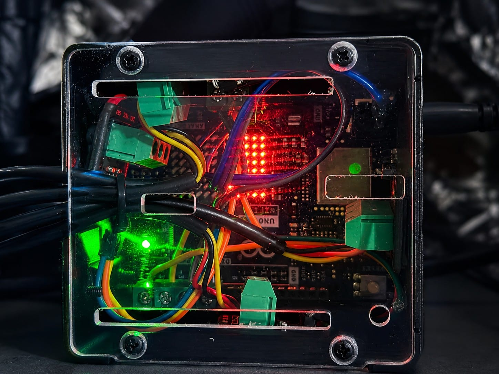
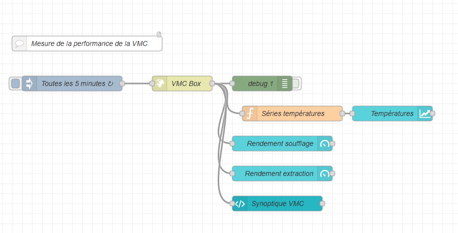
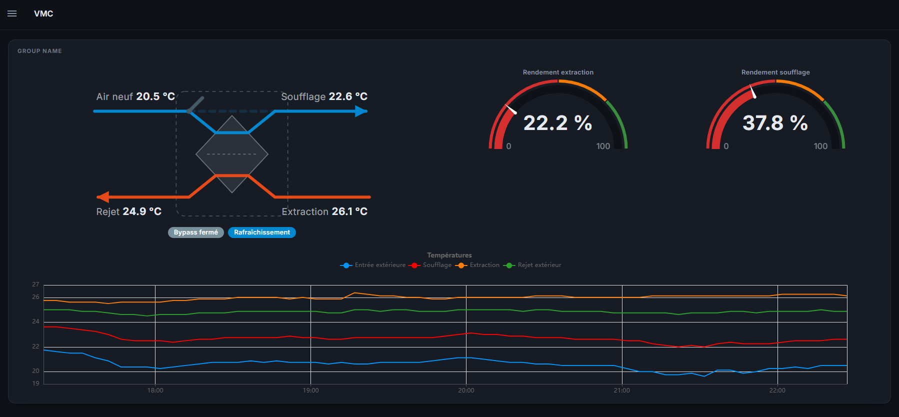

# VMCBox

**Measure the real heat-recovery efficiency of a balanced (double-flow) HRV / VMC with an Arduino UNO R4 WiFi and four DS18B20 probes.**


VMCBox measures the temperature of the four air streams of a double-flow ventilation unit and derives from them the efficiency of the heat exchanger, the state of the summer bypass and the actual effect of the ventilation on the house. Data is exposed as JSON over WiFi and can be plotted in Node-RED (or any home-automation stack).

📝 Full story (in French): [VMC Box : mesurer le rendement réel de sa VMC double flux avec un Arduino](https://www.geeek.org/vmc-double-flux-rendement-arduino/)

## Features

- **Four real measurements**: outdoor intake, supply to rooms, indoor extract, exhaust — no estimated indoor temperature
- **Two independent efficiencies** (supply side and extract side); their gap is a health indicator (unbalanced flows, clogged exchanger, drifting probe)
- **Bypass detection** (summer free-cooling) inferred from the collapse of the supply efficiency
- **House effect**: heating / cooling / neutral, by comparing supply air to indoor air
- **Non-blocking sampling**: DS18B20 conversions run in the background, the HTTP endpoint always answers instantly from cache
- **JSON HTTP API** (`GET /temp`) with CORS enabled
- **LED matrix gauge**: the built-in 12x8 matrix shows the supply efficiency as a bar
- **Built to run unattended**: WiFi auto-reconnect, DHCP hostname, hardware watchdog, boots without a computer attached
- **Serial-only mode** for bench testing (`ENABLE_NETWORK = false`)

## Hardware

| Qty | Part | Notes |
|----:|------|-------|
| 1 | Arduino UNO R4 WiFi | Built-in WiFi and 12x8 LED matrix |
| 4 | DS18B20 waterproof probes | Stainless-steel, ±0.5 °C, adapter module with built-in 4.7 kΩ pull-up |
| – | PCB screw terminals | Solid, removable connections without a custom board |
| 1 | Enclosure for Arduino R4 | A transparent cover keeps the LED gauge visible |



### Wiring

One probe per pin (one independent 1-Wire bus each). Every probe: `VCC → +5V`, `GND → GND`, `DATA →` its pin.

| Pin | Air stream | JSON field |
|-----|------------|------------|
| D1 | Outdoor intake (fresh air, before the exchanger) | `outdoor_intake_C` |
| D3 | Supply to rooms (after the exchanger) | `supply_to_rooms_C` |
| D5 | Indoor extract (stale air from the rooms) | `indoor_extract_C` |
| D7 | Exhaust outside (after the exchanger) | `exhaust_outside_C` |

> Place each probe in the middle of the air flow inside its duct: a probe touching the duct wall measures the duct, not the air.
>
> D1 is also the `Serial1` TX pin. This is fine because the Serial Monitor uses native USB; just don't use `Serial1` in the sketch, or move the probe to another free pin.

## How the efficiency is computed

Supply side (the usual "thermal efficiency"):

```
η_supply  = (T_supply  - T_outdoor) / (T_extract - T_outdoor) × 100
```

Extract side:

```
η_extract = (T_extract - T_exhaust) / (T_extract - T_outdoor) × 100
```

On a balanced unit both values are nearly identical (energy conservation). When the indoor/outdoor spread is below 1 °C the ratio is meaningless and `null` is returned. Below 30 % supply efficiency the bypass is considered open.

## Installation

1. Install the **Arduino UNO R4 Boards** package in the Arduino IDE (provides `WiFiS3`).
2. Install the libraries from the Library Manager:
   - `OneWire` (Paul Stoffregen)
   - `DallasTemperature` (Miles Burton)
   - `aWOT` (Lasse Lukkari)
3. Create a sketch folder `VMCBox/`, copy `VMCBox.arduino` into it as `VMCBox.ino`.
4. Next to it, create `arduino_secrets.h` with your WiFi credentials (keep it out of Git):

   ```cpp
   #define SECRET_SSID "your-ssid"
   #define SECRET_PASS "your-password"
   ```

5. Upload. The board announces itself as `vmcbox` on your network.

Main settings are at the top of the sketch: `ENABLE_NETWORK`, `WIFI_HOSTNAME`, `SENSOR_RESOLUTION_BITS`, `SAMPLE_INTERVAL_MS`, `BYPASS_EFFICIENCY_THRESHOLD`, `SENSOR_PINS`.

## API

`GET http://vmcbox/temp`

```json
{
  "outdoor_intake_C": 5.0,
  "supply_to_rooms_C": 18.2,
  "indoor_extract_C": 20.5,
  "exhaust_outside_C": 7.3,
  "supply_efficiency_percent": 85.2,
  "extract_efficiency_percent": 85.2,
  "bypass_open": false,
  "house_effect": "cooling"
}
```

Invalid readings or undecidable efficiencies are returned as `null`.

## Node-RED dashboard

A Node-RED flow polls the box every 5 minutes and feeds a [Node-RED Dashboard 2.0](https://dashboard.flowfuse.com/) page: live exchanger synoptic, efficiency gauges and 24-hour temperature history.





The exchanger synoptic on the left is a custom **UI Template** node: paste the content of [`NodeRed-VMC.ui`](NodeRed-VMC.ui) into a `ui-template` node fed with the JSON payload from `/temp`. It shows the four temperatures, animates the bypass flap and displays the bypass and house-effect status.

## Limitations

- The bypass state is **inferred**, not measured: a heavily clogged exchanger or unbalanced flows can produce the same signature.
- Temperature-based efficiency assumes **balanced airflows**; if supply and extract volumes differ, the two efficiencies diverge — which is precisely what their gap helps detect.

## Roadmap

- Control the unit directly over the proprietary Aldes iBUS and expose it over MQTT (discussion on the [HACF forum](https://forum.hacf.fr/t/vmc-aldes-easyhome-pureair-premium-aldes-pureflow-mqtt/68269)).

## License

[MIT](LICENSE) © Ludovic Toinel
